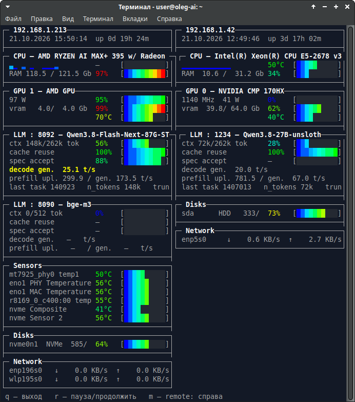

# sysmon-cpp

Компактный мониторинг ПК в C++: TUI в стиле htop (без лишнего) + метрики LLM-серверов llama.cpp.
Одна программа, ноль зависимостей в рантайме (ncurses + curl), сборка одной командой.

C++-переработка bash-скрипта `sysmon.sh`: тот же набор данных, но с box-раскладкой,
плавными цветными барами и одним HTTP-запросом на LLM-сервер.

## Скриншот (v2.0: локальная машина + remote `-ip`, две панели)



## Что показывает

| Секция | Данные | Источник |
|---|---|---|
| **CPU** | модель (в заголовке), загрузка % (бар), температура (бар), load 1/5/15, ядра | `/proc/cpuinfo`, `/proc/stat`, `/proc/loadavg`, thermal_zone / hwmon (k10temp, coretemp) / `sensors` |
| **RAM** | занято/всего GiB, %, swap | `/proc/meminfo` |
| **GPU** (NVIDIA + AMD, все карты) | util % (бар), VRAM GiB, температура (бар), clock MHz, power W, **PCIe-линия** (`PCIe4 x16`, справочная статика) | `nvidia-smi` (CSV), `/sys/class/drm/*/device` + hwmon (amdgpu), `/sys/bus/pci/devices/*/current_link_speed|width` + `max_link_*` |
| **LLM** (llama-server **и** Strata) | заголовок `LLM : порт — модель` / `Strata : порт — модель`, ctx % (бар, занято/лимит tok), cache reuse % (бар), spec accept % (бар), gen tok/s, prefill tok/s, задача (№task / n_t / trnc), **RAM/SWAP процесса модели двумя барами в одну строку** (для llama.cpp/docker; для Strata не рисуется), **MOE-размещение** (Strata): `GPU MOE exp. 24576/24576` + `CPU-prefill = off   cache = 46.8 Gb` — **всё из логов движка** | `/proc/*/cmdline` (в т.ч. контейнерный `llama-server` через cgroup), Strata — `~/.local/state/strata/launch/*.json` + engine.log/server.log; RSS/Swap — `VmRSS`/`VmSwap` из `/proc/PID/status` |
| **Disks** | целые диски: тип (HDD/SSD/NVMe), размер GiB, модель, **занятость ФС** (used/total GiB, %, бар), **io-строка под диском ВСЕГДА** (в паузе `idle`; в работе ↓ чтение / ↑ запись MB/s + busy % ядра и адаптивный бар активности) | `/sys/block/*` (size, queue/rotational, device/model), `/sys/class/nvme/*/model`, `/proc/mounts` + `statvfs` (занятость, вкл. LVM), `/proc/diskstats` (дельты секторов и «ms doing I/O») |
| **Network** | rx/tx MB/s по каждому активному интерфейсу | `/sys/class/net/*/statistics` (дельты) |
| **Sensors** | температуры hwmon-датчиков с барами (NVMe, сетевые PHY/MAC и др.) | `/sys/class/hwmon/*` |

Оформление: весь текст белый, цвет — только у процентов и баров.
Бары — плавный градиент 256-цветной палитры: **синий (0%) → циан → зелёный → жёлтый → красный (100%)**;
цвет цифры % совпадает с цветом бара на её уровне. Поле бара заключено в рамку `[ ]`,
пустые ячейки — видимый серый трек. **Все бары выровнены в одну колонку у правого края**
(значение — справа перед баром), чтобы их было удобно сравнивать. Дата в формате `дд.мм.гггг`.
У дисков — занятость файловой системы (used/total GiB, %, бар); у LLM gen/prefill —
сглаженные значения (среднее из 5 замеров + удержание после нуля).

## Готовые бинарники (v2.0)

| Платформа | Файл | Ссылка |
|---|---|---|
| Ubuntu/Debian (x86-64, glibc) | `sysmon-ubuntu` | [скачать](https://github.com/olegvnovikov75/sysmon-cpp/releases/download/v2.0/sysmon-ubuntu) |
| Windows (console, x86-64, статический) | `sysmon-windows-console.exe` | [скачать](https://github.com/olegvnovikov75/sysmon-cpp/releases/download/v2.0/sysmon-windows-console.exe) |
| Исходники | `sysmon-cpp-v2.0-src.tar.gz` | [скачать](https://github.com/olegvnovikov75/sysmon-cpp/releases/download/v2.0/sysmon-cpp-v2.0-src.tar.gz) |

Примечание: Windows-бинарник v2.0 пересобран (mingw, статический) — проверен в wine: snapshot, TUI, JSON-сервер. На чистой Windows без WSL секции CPU/RAM/Disks/Sensors могут быть пустыми (/proc и /sys нет), GPU через nvidia-smi и LLM работают.

Все релизы: [github.com/olegvnovikov75/sysmon-cpp/releases](https://github.com/olegvnovikov75/sysmon-cpp/releases)

### Установка (Ubuntu/Debian)

```bash
# зависимости (обычно уже стоят): libncursesw6, libtinfo6, libcurl4
sudo apt install libncursesw6 libtinfo6 libcurl4

curl -L -o ~/sysmon https://github.com/olegvnovikov75/sysmon-cpp/releases/download/v2.0/sysmon-ubuntu
chmod +x ~/sysmon
sudo mv ~/sysmon /usr/local/bin/sysmon   # или оставить в ~
sysmon
```

### Установка (Windows)

1. Скачать `sysmon-windows-console.exe` (статический, зависимостей не требует).
2. Запустить двойным кликом или из cmd/PowerShell (консоль создаётся сама).
3. Клавиши: `q`/ESC — выход, `r`/пробел — пауза, `m` — режим второй панели.

Примечание: на Windows секции CPU/RAM/Disks/Sensors читают `/proc` и `/sys`,
поэтому без WSL они могут быть пустыми; GPU (`nvidia-smi`) и LLM работают.

## Сборка

Требования: g++ (C++17), make, libncursesw, libcurl.

**Ubuntu/Debian:**
```
sudo apt install g++ make libncursesw6 libncurses-dev libcurl4-openssl-dev
make
```

**Arch:** `sudo pacman -S base-devel ncurses libcurl`
**Fedora:** `sudo dnf install gcc-c++ make ncurses-devel libcurl-devel`

Сборка: `make` (флаг `-O2`, линкуется `-lncursesw -lcurl`), очистка: `make clean`.
Бинарник переносим между машинами с одинаковой glibc (проверено: Ubuntu 24.04.4 → 24.04.1).

## Использование

```
sysmon                 # TUI, обновление каждые 2 сек
sysmon -w 5            # TUI, каждые 5 сек
sysmon -1              # один текстовый снимок (для пайпа/логов/скриптов)
sysmon -ip 192.168.1.40   # TUI + данные другого ПК (его sysmon -h), по умолчанию — справа
sysmon -ip 192.168.1.40:18081   # ...с явным портом (host:port)
sysmon -ip 192.168.1.40 -p 18081   # ...на нестандартном порту
sysmon -h              # скрытый режим: JSON-сервер на 0.0.0.0:18080 (GET /)
sysmon -h -p 18081     # ...на другом порту
sysmon --help          # справка
```

Клавиши (TUI): `q` / ESC / Ctrl+C — выход, `r` / пробел — пауза/продолжить,
`m` — remote: справа → снизу → отключено (если запущен с `-ip`).
Работают и в русской раскладке: `й` = q, `к` = r, `ь` = m.

Консолидация двух ПК: на удалённом ПК запускается `sysmon -h` (JSON-сервер),
на основном — `sysmon -ip <адрес>`. Второй ПК показывается справа (две равные
панели, расширяются/сужаются вместе с окном) или снизу; бары в узкой панели
сужаются пропорционально. Футер (`q — выход ...`) — всегда на последней строке окна.

Текстовый режим (пример):
```
userver  |  20.08.2026 01:49:47  |  up 0d 05h
CPU:    3%  @ 44°C   load: 1.11 0.96 0.73   cores: 24   Intel(R) Xeon(R) CPU E5-2678 v3 @ 2.50GHz
RAM:  12.4 / 31.2 GiB  ( 40%)   Swap: 0.00 / 8.00 GiB
  GPU0  NVIDIA CMP 170HX              util   0%  vram  42.5/ 64.0 GiB (66%)  49°C  1140 MHz  43 W
  nvme0n1  NVMe   238.5 GiB  HUANANZHI 256G
  sda      HDD  1863.0 GiB  WDC WD20PURZ-85A
  sdd      HDD   71.6 /   422.1 GiB    17%  WDC WD5000AAKX-0
  LLM  port  1234  qwen38-27b-uncensored   ctx  87% (229k/262k tok)
       gen   34.2 tok/s   prefill   12.0 tok/s   cache reuse  95%   spec accept  82%
```

## Как устроено

```
include/collector.h   структуры данных (CPU/RAM/GPU/Sensor/Disk/Net/LLM) + класс Collector
src/collector.cpp     сбор данных: /proc, /sys, nvidia-smi, /proc/*/cmdline + парсинг лога llama-server
include/api.h         JSON-сериализация снимка + ApiServer (POSIX-сокеты) + fetch_remote
src/api.cpp           свой минимальный JSON-парсер (без внешних библиотек)
src/tui.cpp           ncurses-рендер: box-секции, градиентные бары, 256-цвет, remote-режимы
src/textout.cpp       текстовый снимок (-1)
src/main.cpp          аргументы, сигналы (SIGINT/SIGTERM → чистый выход), curl_global_init
Makefile              g++ -std=c++17 -O2, -lncursesw -lcurl (заголовки — в зависимостях)
```

Один цикл: `collect()` (все источники, ~10 мс) → отрисовка кадра → `getch()` с таймаутом интервала.
Без потоков, без аллокаций в горячем цикле (кроме строковых буферов), без внешних зависимостей
помимо ncurses/curl.

## Примечания

- **Температура CPU:** сначала `thermal_zone*` (x86_pkg_temp/cpu_thermal/soc_thermal/coretemp),
  затем hwmon (k10temp/coretemp/x86_pkg_temp), fallback — `sensors | grep Tctl`.
- **NVIDIA:** `nvidia-smi --format=csv,noheader,nounits` (VRAM приходит в MiB);
  работает с кастомными драйверами (проверено на CMP 170HX, драйвер 610.43.03 ручной сборки —
  отдаёт util/VRAM/temp/clocks/power).
- **AMD:** утилизация/VRAM/температура из `/sys/class/drm/cardN/device`, power из hwmon
  (amdgpu power1_input); имя — через lspci, если в pci.ids нет имени («Device xxxx») — «AMD GPU».
- **LLM:** серверы находятся по `llama-server` в `/proc/*/cmdline`; порт и лимит контекста
  (`-c`/`--ctx-size`) — из аргументов. Метрики (v1.7.0) — парсинг лога llama-server:
  программа находит путь к `serverlog.txt` по cmdline/окружению процесса и держит скользящее
  окно последних 500 строк. Маркеры: `stop processing: n_tokens = X` → ctx;
  `draft acceptance rate = X (Y accepted / Z generated)` → spec accept %; `prompt eval time =
  A ms / B tokens` → prefill = B/A*1000 t/s; `tg = X t/s` → gen; `LCP similarity, sim_best = X`
  → cache reuse. LLM-лог — единственный источник данных (v1.8: GET `/metrics` полностью удалён);
  ctx % = min(n_tokens из лога, лимит) / лимит.
- **Sensors:** все hwmon-датчики, кроме CPU (k10temp/coretemp) и GPU (amdgpu) — они уже
  в своих секциях; отсев мёртвых зон (acpitz, ACAD) и значений вне 1–150°C.
- **Disks:** только целые диски (партиции имеют symlink `partition` — отсекаются);
  skip loop/ram/dm-/sr/zram/md и устройств с `size=0` (мёртвые слоты кардридера —
  SD/MMC, Compact Flash и т.п.); тип: NVMe по имени, иначе `queue/rotational` (1=HDD, 0=SSD);
  модель: SCSI/SAS — `device/model`, NVMe — `/sys/class/nvme/nvmeX/model`.
  Занятость — по смонтированным ФС на партициях диска (blkid + statvfs, вкл. LVM);
  если ФС не смонтирована — размер + `[fs]` и `unknown` вместо бара (100% не вешаем).
- **Цвета баров:** две гаммы. «Безопасная» (CPU, VRAM): синий→зелёный — 100% нагрузки
  нормально. «Опасная» (RAM, температура, ctx, диски): синий→красный — 100% = неисправность.
- **LLM-секция** показывается только если найден запущенный `llama-server`;
  gen/prefill — одной строкой (v1.8: busy/reqs удалены, сглаживание больше не используется).
- **Правила §6.8c (v1.6.0):** ctx — никогда не 0 (записываем `n_tokens_max`, кроме 0, держим
  предыдущее значение; ctx % пересчитывается из него); cache reuse / spec accept —
  статистика за сессию: при недоступности держим предыдущее значение, не обнуляем.
- **API:** `sysmon -h` отдаёт JSON-снимок на `0.0.0.0:18080` (GET /) — тот же формат,
  что и внутренний снимок Collector; клиент `-ip` парсит его своим минимальным JSON-парсером.
- **Сеть:** показываются только интерфейсы в `operstate=up`, без lo/veth/br-/docker/tailscale.

## Релизы
- **v2.2d** (02.11.2026, директивы Шефа) — компактнее и без «мигания»:
  - **MOE-блок Strata: 4 строки → 2:** `GPU MOE exp. 24576/24576` (было `MOE experts … on GPU`) и
    `CPU-prefill = off   cache = 46.8 Gb` в одну строку. `VRAM free …` из TUI убран — остаток VRAM виден
    в GPU-секции выше (в JSON `moe_vram_free_gb` осталось).
  - **`mem RAM … swap …` → два бара в одну строку:** `RAM 11.3G [█░░░░░░░░] SWAP 2.0G [█░░░░░░░░]`
    (шкала от системного тотала: 11.3 GiB из 121.5 GiB ≈ 9%). Это RAM/SWAP **самого процесса модели**
    (`VmRSS`/`VmSwap`): веса + контекст, которые движок держит в ОЗУ — не вся система.
    Для Strata строка не рисуется (расход и так видно в секциях RAM/GPU).
  - **io-строка диска не исчезает:** стоит постоянно под строкой диска; в паузе `io sda idle` с пустым
    баром, в работе — ↓/↑ и значения (панель не «прыгает» по высоте).
  - **Бар io адаптирован:** вместо busy % ядра (на X99 у NVMe он не ходит → всегда 0) бар = доля от
    реального потолка устройства в **лог-шкале** (NVMe 1200 / SATA SSD 550 / HDD 180 MB/s):
    0.1 МБ/с ≈ пусто, 30 МБ/с ≈ треть, 570–700 МБ/с ≈ полный. Число слева от бара — busy % ядра или `—`.
  - JSON: добавлены `llms[].moe_experts|moe_total|moe_place|moe_cpu_prefill|moe_cache_gb|moe_vram_free_gb`;
    если удалённый сервер старой версии их не отдаёт — TUI откатывается на прежний перенос строки `moe`.
- **v2.2** (02.11.2026) — диагностика Strata (MOE-движок) без потери совместимости с llama.cpp:
  заголовок `Strata : порт — модель`, порты/имя модели/пути логов из launch-JSON
  (`~/.local/state/strata/launch/*.json`), мёрж engine.log (итоги запроса, старт-конфиг MOE)
  и server.log (живые строки) с раздельными offset/inode; поддержка чисел с разделителями
  тысяч (`24,030`); строка `MOE` — эксперты/размещение, CPU-prefill, expert cache GiB, VRAM free
  (перенос по `·` в узкой панели, без обрезки); `mem RAM/swap` процесса модели (`VmRSS`/`VmSwap`);
  GPU: справочная PCIe-линия (`PCIe1..6 xN`, из sysfs `current/max_link_speed|width`, кэш по индексу);
  Disks: io-строка ↓/↑ MB/s + busy % из дельт `/proc/diskstats`, строка показывается только при
  активности; fix: RSS для моделей в docker (`docker run` на хосте → берётся процесс контейнера с
  max RSS, cgroup v2 `docker-…​.scope` распознаётся); fix: парсер expert cache брал число слотов
  вместо GiB (было `24576.0 Gb`); JSON: `gpus[].pcie`, `llms[].engine|moe|rss_gb|swap_gb`,
  `disks[].read_mbs|write_mbs|busy_percent` (старые серверы читаются без падений, новое — пусто/−1).
  Примечание: на части ядер (blk-mq/NVMe, ядро 6.8 на X99) счётчик «ms doing I/O» не двигается при
  честном трафике — в этом случае busy % показывается как `—` (unknown), а не как `0%`.
- **v2.0** (21.10.2026) — переработан layout по директиве Шефа: порядок секций CPU→GPU→LLM→
  Sensors→Disks→Network; ни одна строка не длиннее панели (кламп, без переносов) — рамки целы при
  любом resize; `KEY_RESIZE` мгновенный; индикаторы загрузки ядер `▁▂▃▄▅▆▇█`; RAM строкой в CPU-блоке
  (`Gb`, без swap); LLM: главная по ctx_limit, активная фаза `gen`/`prefill` жёлтым, реалтайм-обновление
  каждые 0.5 c (collect_fast), инкрементальный парсинг serverlog.txt; часы remote тикают (ts+drift);
  Network вниз + KB/s при малом трафике; шапка без SYSMON/имени/user (только IP); кредит внизу;
  fix: JSON-парсер ест не-компактный JSON (пробелы); fix: удалённые часы (дд.мм.гггг);
  fix: незакрытая кавычка model в JSON. **Windows-бинарник пока v1.5.0** (cross-библиотеки не пересобраны).

- **v1.9c** (13.09.2026) — LLM: decode gen из лога ('tg = X t/s', держим предыдущее при недоступности); prefill upl./gen. (прогресс ≤30 замеров + 'prompt eval time')
- **v1.9b** (13.09.2026) — merge_h: когда left-frame title_cont → правый хвост тоже пробелами (без черты); prefill без лишних пробелов

- **v1.8.0** (13.09.2026) — LLM: полностью убран источник `/metrics` (GET к серверу,
  busy_slots, requests_processing, metrics_ok) — единственный источник данных теперь лог
  llama-server (`serverlog.txt`, скользящее окно 500 строк); TUI/textout/API-JSON приведены
  в соответствие; эпизодическое «(метрики недоступны)» при недоступности /metrics больше не возникает.
- **v1.7.0** (11.09.2026) — LLM-метрики из лога llama-server (`serverlog.txt`, скользящее окно
  500 строк; маркеры: `stop processing` → ctx, `draft acceptance rate` → spec accept,
  `prompt eval time = A ms / B tokens` → prefill = B/A*1000, `tg = X t/s` → gen,
  `LCP similarity, sim_best` → cache reuse); `/metrics` — только busy/requests (там правда).
- **v1.6.0** (11.09.2026) — правила §6.8c: ctx никогда не 0 (держим предыдущее значение,
  пересчёт % из него); cache reuse / spec accept держатся при недоступности
  (статистика за сессию, ≈ одна цифра для модели, не обнуляем).
- **v1.5.0** (20.08.2026) — название **SYSMON** в заголовке + кредит
  «Designed by Chip and Gayechka (openclaw)» справа (если помещается);
  готовые бинарники на GitHub: Ubuntu (x86-64) и Windows (console, статический);
  установка — см. «Готовые бинарники».
- **v1.4.0** (20.08.2026) — remote по умолчанию справа (две равные панели);
  футер — всегда на последней строке окна; длина баров адаптивная (сужаются с окном);
  LLM gen/prefill и busy/reqs — двумя строками; диски без смонтированной ФС —
  `unknown` вместо бара; русская раскладка клавиш (й/к/ь); курсор скрыт каждый кадр.
- **v1.3.0** (20.08.2026) — API/консолидация: `sysmon -h` (JSON-сервер :18080),
  `sysmon -ip <адрес>` (данные второго ПК, клавиша m — справа/снизу/отключено);
  LLM-секция только при запущенном сервере и в самом низу; среднее из 5 показаний
  + удержание ненулевого значения 60 сек; две цветовые гаммы баров (safe/danger);
  VRAM-бары у GPU; диски — по партициям с ФС (blkid+statvfs); значения выровнены
  по левому краю столбика.
- **v1.2.0** (20.08.2026) — все прогресс-бары выровнены в одну колонку у правого края
  (значение — справа перед баром); у дисков — занятость ФС (used/total GiB, %, бар,
  детект через /proc/mounts + statvfs, вкл. LVM); LLM gen/prefill/busy/reqs — сглаженные
  значения (среднее из 5 замеров + удержание последнего ненулевого после нуля).
- **v1.1.0** (20.08.2026) — бары в рамке `[ ]` + видимый трек; LLM ctx/cache reuse/
  spec accept — прогресс-бары; дата `дд.мм.гггг`; модель CPU в заголовке секции;
  секция Disks (HDD/SSD/NVMe: тип, размер, модель, отсев партиций и слотов кардридера).
- **v1.0.0** (20.08.2026) — TUI: градиентные бары 256-цвет, цвет % = цвет бара,
  температуры CPU/GPU со своими барами, секция Sensors (NVMe/NIC), GPU power,
  LLM-метрики (gen/prefill tok/s, cache reuse, spec accept), текстовый режим,
  NVIDIA+AMD, переносимый бинарник.

## Локации (правило §1.9.6)
- dev-оригинал: oleg-ai `~/Projects/sysmon-cpp/` (этот репозиторий)
- релиз-копии: .40 `~/Projects/sysmon-cpp/` (без .git) и др.
